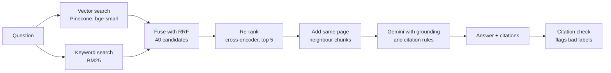

# RAG Accuracy Lab


https://github.com/user-attachments/assets/75d9457b-54d9-4fa5-ab2e-9f78d41214dc


A "chat with your documents" assistant for US payroll questions, built to answer one question: **how wrong is a typical RAG chatbot, and which fixes actually help?**

I built a naive version, measured it on 50 hand-written questions, then improved it one change at a time and re-measured after every change, including the changes that made it worse.

> Reports what IRS publications say; not tax advice.

## Results

| | Naive baseline (v0) | Final (v6) |
|---|---|---|
| Right evidence retrieved (of 39 answerable) | 22/39 | **37/39** |
| Correct answers (of 39 answerable) | 30/39 | **34–37/39** |
| Answers supported by the retrieved text | 44/50 | **38/38–39/39** |
| Unanswerable questions correctly declined (of 11) | 10/11 | **10–11/11** |
| Answers with valid citations | none required | **38/38–38/39** |
| Latency per question | 1.46 s | 2.77 s |

Two numbers (a–b) mean two runs of the same code. Answers vary between runs, so a single run can't show a small gain.

### What each change did

| Version | Change | Hit@5 | Evidence | Correct | Latency |
|---|---|---|---|---|---|
| v0 | Naive: fixed 1,000-character chunks, vector search, top 5, plain prompt | 0.795 | 22/39 | 30/39 | 1.46 s |
| v1 | + Re-ranking with a cross-encoder | 0.897 | 26/39 | 33–34/39 | 1.60 s |
| v2 | + Neighbouring chunks from the same page | 0.897 | 35/39 | 36/39 | 2.54 s |
| v3 | + Hybrid search (BM25 keywords + vectors, fused with RRF) | 0.974 | 37/39 | 36–37/39 | 2.63 s |
| v4 | Gemini embeddings instead of BM25 (**not kept**) | 1.000 | 38/39 | 37/39 | 3.62 s |
| v5 | v3 + grounding rules, required citations, labelled context | 0.974 | 37/39 | 35/39 | 2.77 s |
| v6 | + "calculate from the context" rule, one citation per bracket | 0.974 | 37/39 | 34–37/39 | 2.77 s |

- **Biggest single win: hybrid search.** Keyword search finds chunks that use the question's exact terms (form numbers, amounts) but aren't close in meaning, which vector search alone missed.
- **Neighbouring chunks** fixed answers that were split across a chunk boundary: evidence in the context rose from 26/39 to 35/39 with no change in ranking.
- **Better embeddings (v4)** retrieved slightly better but answered no better and were slower (3.62 s against 2.63 s), so v3's setup stayed.
- **Tried and dropped:** a recursive text splitter and cleaning boilerplate text before chunking. Both looked sensible and both lowered retrieval scores.
- **Prompt rules (v5–v6)** didn't raise accuracy, but nearly every answer now cites its source page, and refusals use one fixed sentence.

Full details, including every failed experiment: [EXPERIMENTS.md](EXPERIMENTS.md).

## How it was measured

- **Corpus:** 20 IRS payroll PDFs (314 pages), the 2026 revisions. See [corpus/SOURCES.md](corpus/SOURCES.md).
- **Golden set:** 50 questions written by hand, 39 answerable (each with its source page and a quote as evidence) and 11 that the documents can't answer. See [evals/golden.jsonl](evals/golden.jsonl).
- **Retrieval metrics:** Hit@5 (is a correct page in the top 5) and evidence found (is the quoted text in what the model saw).
- **Answer metrics:** correctness, faithfulness and abstention, scored by an LLM judge. Each judge was checked against hand labels before use, and judge results that changed a conclusion were checked by hand.
- **Noise:** each version that mattered was run twice. In the baseline, only 12 of 50 answers had identical text across two runs.

## Architecture



- **Indexing (offline):** PDFs → pages → 1,000-character chunks → embeddings → Pinecone. The chunks are also saved to `data/chunks.jsonl`, so serving needs no PDFs.
- **Serving:** FastAPI streams the answer to a single-page chat UI with server-sent events, then shows links to the cited IRS pages.
- **Tracing:** every question is one LangSmith trace (retrieval, then the LLM call), tagged with the commit, prompt version and whether the answer refused or had bad citations.

**Stack:** Python 3.12 · LangChain · Pinecone · Gemini · sentence-transformers (bge-small-en-v1.5, ms-marco-MiniLM cross-encoder) · rank-bm25 · FastAPI · LangSmith · Docker

## Limitations

- **Small eval set.** 50 questions show large effects clearly, but differences of 1–2 answers are within run-to-run noise.
- **LLM judge.** The judge was calibrated against hand labels, but it still makes occasional errors; known ones are listed in EXPERIMENTS.md.
- **Known failures in the final version:**
  - one question where the evidence is never retrieved;
  - one false refusal (the evidence is retrieved, but the model doesn't connect "Bitcoin" to "digital assets");
  - one unanswerable question that is sometimes answered anyway.

  A prompt rule that fixed the false refusal broke the unanswerable one, so both are accepted as a trade-off.
- **Citation check** confirms that a cited page was given to the model, not that the page supports the claim.
- **Corpus scope:** only the 20 listed IRS documents, for the 2026 tax year.

## How to run

You need API keys for Gemini, Pinecone and (optionally) LangSmith, in a `.env` file:

```
GOOGLE_API_KEY=...
PINECONE_API_KEY=...
LANGSMITH_API_KEY=...
LANGSMITH_TRACING=true
```

**With Docker:**

```bash
docker build --build-arg GIT_COMMIT=$(git rev-parse --short HEAD) -t rag-api:0.1.1 .
docker run --rm --env-file .env -p 8000:8000 rag-api:0.1.1
```

Then open http://localhost:8000.

**Without Docker:**

```bash
python3.12 -m venv .venv && .venv/bin/pip install -r requirements.txt
.venv/bin/uvicorn api:api --reload
```

**Indexing and evals** (needs the PDFs):

```bash
.venv/bin/python corpus/download.py   # download the 20 PDFs
.venv/bin/python -m rag.store         # chunk, embed and upload to Pinecone
.venv/bin/python evals/run.py         # run the full eval (50 questions)
.venv/bin/python evals/run.py q21     # run one question
.venv/bin/pytest                      # unit tests
```

The free Gemini tier allows about 15 requests per minute, so a full eval run takes several minutes.
